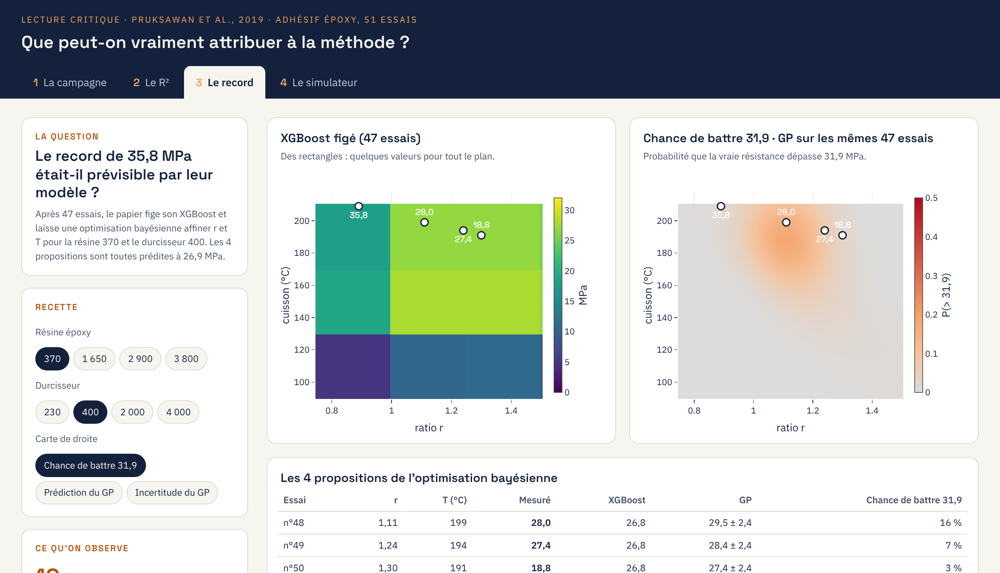
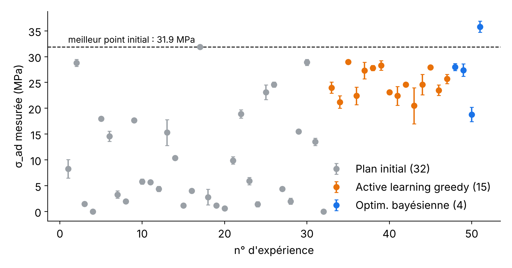
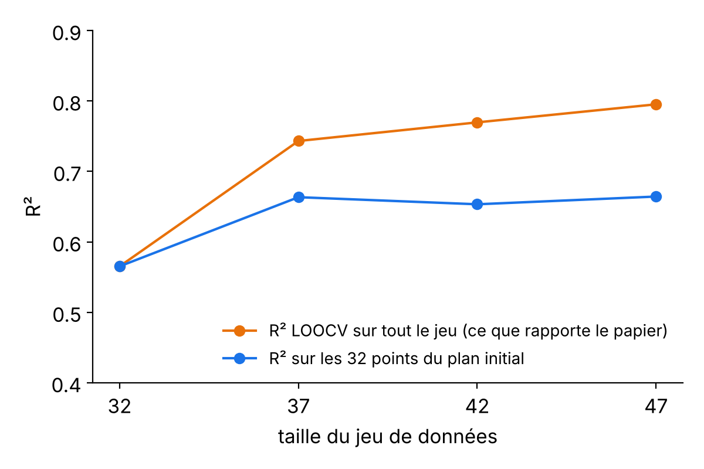
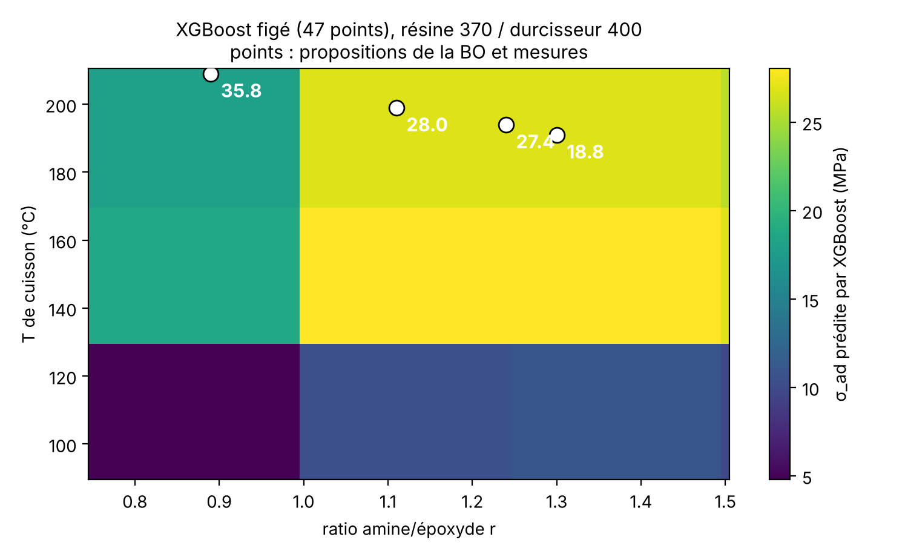
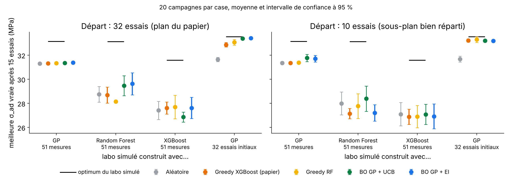

# Active learning on a small materials dataset: a critical reproduction

[](https://github.com/allardlucas/epoxy-active-learning/actions/workflows/ci.yml)



*The explorer app (tab 3, "Le record"). Run it with one command: see [Explorer app](#explorer-app-one-docker-image).*

Reproduction and stress-test of **Pruksawan et al., "Prediction and optimization of epoxy adhesive strength from a small dataset through active learning"**, *Sci. Technol. Adv. Mater.* 20 (2019) 1010–1021, [doi:10.1080/14686996.2019.1673670](https://doi.org/10.1080/14686996.2019.1673670).

The paper designs an epoxy adhesive from **32 lab experiments**: a Graeco-Latin design, an XGBoost model, 3 "active learning" cycles of 5 experiments, then Bayesian optimization. Its best adhesive reaches **35.8 MPa** in lap shear. This repo asks three questions:

1. Do the published numbers reproduce from the published data?
2. Does the reported accuracy gain (R² 0.68 to 0.85) reflect a better model?
3. Is the paper's greedy loop a good way to spend 15 experiments, compared with uncertainty-aware Bayesian optimization?

## Key findings

| Question | Finding |
|---|---|
| Did active learning find better adhesives? | None of the 15 active-learning proposals beats the best point already in the initial design (31.9 MPa, sample 17). Only the BO step goes higher.  |
| Did the model really improve? | Partly. LOOCV R² rises from 0.57 to 0.80 as data is added, but on the 32 original design points it only goes from 0.57 to ≈0.66. The 15 added points sit in one high-strength region and are near-duplicates, so LOOCV on them is optimistic.  |
| Was the 35.8 MPa record predictable? | No. The fixed XGBoost is piecewise constant: only 10 distinct values over the whole (r, T) plane, and the same prediction for 3 of the 4 BO proposals (the paper reports 26.9 MPa for all 4). A GP fitted on the same 47 points gave the record a 2 % chance of beating 31.9 MPa; the measurement sits 3.5 sd above its prediction (and the 18.8 MPa proposal 3.6 sd below).  |
| Which acquisition strategy is best? | **No robust winner.** On 4 simulated labs × 2 initial designs, greedy XGBoost (the paper) and GP-based BO are within 1 MPa of each other; the only statistically significant gaps are small (+0.1 to +0.6 MPa for GP-EI, on GP labs only). Model-based strategies beat random search clearly only on the smoothest lab (+1.5 MPa). On tree-based labs, no strategy finds the narrow peak created by the single 35.8 MPa measurement. On this 4-variable problem, a good initial design does most of the work. **Ablation:** the same GP ranking recipes by its mean only (no uncertainty) does as well as GP-EI on every lab (no significant difference, p ≥ 0.06): where the GP strategies beat greedy XGBoost, the gain comes from the smoother model, not from exploration.  |

Model selection on 32 points is fragile: Random Forest (R² 0.65) and XGBoost (0.57) cannot be separated (bootstrap 95 % CI of the difference: −0.07 to +0.23).

## Method

- **Data**: `data/epoxy_adhesive_dataset.csv`, the 51 published measurements (Tables S2, S3 and 3), with the qualitative "appearance" notes (uncured, soft, no adhesion), which the paper does not use.
- **Reproduction** (`src/reproduce.py`): Elastic Net, Random Forest and XGBoost with the paper's hyperparameters (Table S4), leave-one-out CV, standardized features.
- **Simulated labs** (`src/benchmark.py`): an "oracle" gives the true strength of each recipe, and each measurement adds 2 MPa Gaussian noise. Four oracles avoid favouring one model family: GP, Random Forest and XGBoost fitted on all 51 measurements, and a GP fitted on the 32 design points only. Search space: 4 × 4 molecular weights × 16 ratios × 13 cure temperatures = 3,328 recipes.
- **Strategies**: random; greedy top-5 with XGBoost (the paper) or Random Forest, with random tie-breaking; greedy top-5 on a GP mean (`gp_mean`, ablation: same GP and batching as BO, without uncertainty); batch BO with a GP and Expected Improvement or UCB (batches via the kriging-believer heuristic, GP hyperparameters frozen within a batch). Each strategy runs 3 batches of 5 experiments, over 20 paired seeds and 2 initial designs (the full 32-point design, or a 10-point maximin subset of it). Metric: true strength of the best recipe tested so far, initial points included; paired Wilcoxon tests in `results/benchmark_stats.csv`.
- **BO replay** (`src/replay_bo.py`): the paper's fixed XGBoost (cycle-3 hyperparameters, 47 points) mapped over r and T for the 370/400 recipe, and a noisy GP on the same data evaluated at the 4 BO proposals.

## Run

```bash
pip install -r requirements.txt
python src/reproduce.py      # model comparison and AL cycles (~1 min)
python src/benchmark.py      # strategy benchmark (~15 min on 4 cores)
python src/replay_bo.py      # replay of the paper's BO step
python src/figures.py        # figures in results/
pytest -q
```

## Explorer app (one Docker image)

**Online**: the CI publishes the app to a Hugging Face Space (free CPU) once the tests and the Docker build pass: `https://huggingface.co/spaces/<hf-user>/epoxy-explorer`. The Space sleeps after 48 h without visits and takes about a minute to wake up.


An interactive version of the analysis: a React front end over a small FastAPI server that calls the same code as `src/`.

```bash
docker build -t epoxy-explorer .
docker run --rm -p 8000:8000 epoxy-explorer
# then open http://localhost:8000
```

Four tabs, one per question (screenshots in `docs/screenshots/`):

1. **La campagne**: the 51 trials in order, recipe by recipe; none of the 15 active-learning proposals beats trial 17.
2. **Le R²**: LOOCV R² on all points vs on the 32 DoE points, for XGBoost, Random Forest or ElasticNet, with the paper's hyperparameters or not.
3. **Le record**: the fixed XGBoost map (a few flat plateaus) next to a GP's mean, uncertainty and probability of beating 31.9 MPa, for any resin/hardener pair.
4. **Le simulateur**: replay a 15-trial campaign on a simulated lab with 6 strategies, plus the precomputed 20-seed benchmark.

The image is based on `python:3.11-slim` and installs only the runtime dependencies (`app/requirements-app.txt`): no matplotlib or pytest.

Development mode, without Docker:

```bash
pip install -r requirements.txt -r app/requirements-app.txt   # app + figures + tests
cd app/api && uvicorn main:app --reload --port 8000     # API
cd app/web && npm install && npm run dev                # front end on :5173, proxies /api
```

## Limits (and what I would do next)

- Simulated labs are built from 51 points, so they inherit the paper's sampling: the 35.8 MPa peak rests on a single measurement. Conclusions about strategies are about this problem size (4 variables), not BO in general.
- The features are process settings, not chemistry: the model cannot generalize to a new resin or hardener. Next step: physical descriptors (epoxy/amine equivalent weights, theoretical crosslink density) or a GNN on the monomers, evaluated with leave-one-molecular-weight-out CV.
- Real projects are constrained and multi-objective: an uncured or non-adhesive sample is a failed experiment. Next step: a feasibility classifier on the appearance notes, plus constrained or multi-objective BO (qNEHVI).
- Measurement: 10 kN over 25 × 12.5 mm caps the first tensile machine at 32.0 MPa, so sample 17 (31.9 ± 0.1) may be right-censored. The best recipe was not replicated.
